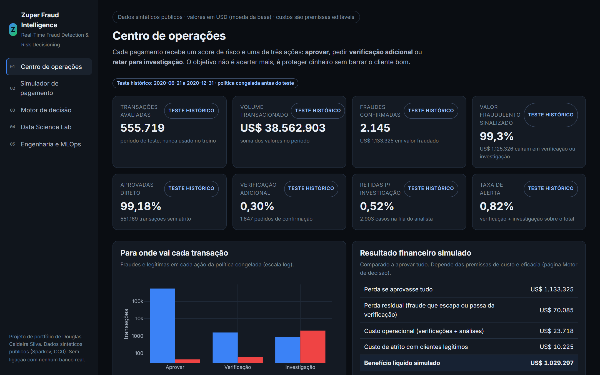
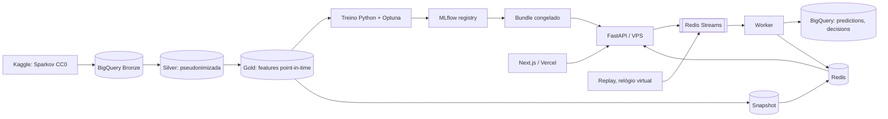
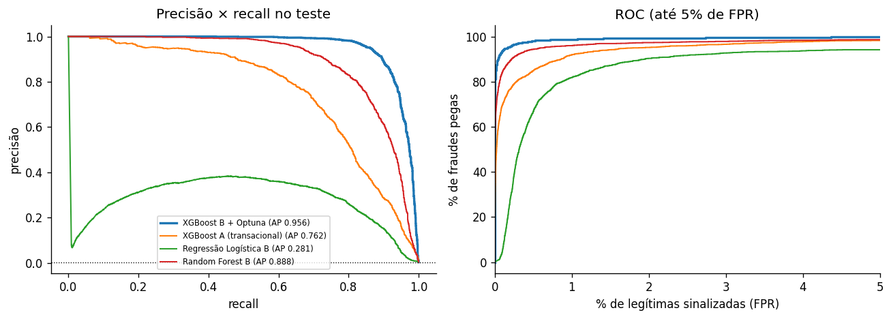

# Zuper Fraud Intelligence

**Real-Time Fraud Detection & Risk Decisioning**: um sistema antifraude de ponta a ponta. A cada pagamento, ele calcula o risco a partir do **histórico de comportamento do cartão**, escolhe uma ação (aprovar, pedir verificação ou reter para investigação) e registra tudo para auditoria e monitoramento.

> Projeto de portfólio de **Douglas Caldeira Silva**. Usa **dados sintéticos públicos** (Sparkov, CC0) e não tem ligação com nenhum banco real. Os custos da política são **premissas editáveis**, não valores de mercado.

| | |
|---|---|
| **Aplicação** | https://zuper-fraud-intelligence.vercel.app (5 páginas: operações, simulador, motor de decisão, Data Science Lab e MLOps) |
| **API** | https://zfi-api.2-29-40-32.sslip.io/docs (FastAPI, VPS própria) |
| **Evidências** | `reports/` (métricas, curvas, testes, carga) · `docs/prints/` (prints reais) · `docs/DIARIO.md` (como foi feito, incluindo os erros) |



## O problema de negócio

Fraude não se resolve maximizando acurácia. Aprovar tudo e "acertar" 99,6% das transações custaria **US$ 1,13 milhão** em fraudes no período de teste. Barrar demais também custa, porque perde o cliente bom e lota a fila do analista. Por isso o sistema separa duas coisas:

- **o modelo estima o risco**;
- **o motor de decisão escolhe a ação** pelo custo esperado: custo da verificação ou da análise, atrito com o cliente legítimo e perda da fraude que passa.

**Resultado no período de teste** (555.719 transações, de 21/06 a 31/12/2020, com a política congelada antes do teste):

| | |
|---|---|
| Aprovadas direto, sem atrito | **99,18%** |
| Verificação adicional / retidas para investigação | 0,30% / 0,52% |
| Valor fraudulento sinalizado | **99,3%** (US$ 1,13 mi de US$ 1,13 mi) |
| Fraudes que passaram direto | 44 de 2.145 |
| Benefício líquido simulado contra "aprovar tudo" | **US$ 1,03 mi** (premissas na página Motor de decisão) |
| Política de 3 níveis contra a de 1 corte | custo total 11% menor (US$ 104 mil contra US$ 117 mil) |

## O que diferencia este projeto

1. **Features de comportamento point-in-time.** Ticket médio, velocidade, loja nova, hábito por categoria e movimento da loja são calculados no BigQuery com janelas que terminam 1 segundo **antes** de cada transação. Um teste automatizado confere que a mesma feature dá o mesmo valor no BigQuery (offline) e na API (online).
2. **Ablação honesta.** Nas **mesmas linhas de teste** e com os mesmos parâmetros, o histórico do cliente leva a AP de **0,763 para 0,955**.
3. **Decisão por custo em 3 níveis.** Os cortes são otimizados numa janela própria, com análise de sensibilidade, e comparados com "aprovar tudo" e com a política de um corte.
4. **Probabilidade calibrada.** O Brier no teste cai de 0,000588 para 0,000551, com calibração sigmoide escolhida numa janela separada.
5. **Arquitetura de produção em miniatura:**
   - FastAPI com o modelo em memória e o Redis como feature store online;
   - Redis Streams com consumer group, ACK depois de persistir, reentrega e fila de mensagens envenenadas (DLQ);
   - worker que grava no BigQuery;
   - MLflow com registry e aliases;
   - challenger em modo sombra;
   - replay com relógio virtual, rótulo atrasado em 30 dias e PSI de drift.
6. **Evidência verificável:**
   - 41 testes automatizados, com saída e exit code guardados;
   - teste de carga com as condições declaradas;
   - 2 revisões independentes por etapa, registradas no `DIARIO.md` com os bugs que pegaram.

## Arquitetura



O caminho síncrono **não consulta o BigQuery**: perfil no Redis, modelo em memória e decisão. Detalhes, segurança e rollback em [`docs/architecture.md`](docs/architecture.md).

## Dados

Base Sparkov (Kaggle `kartik2112/fraud-detection`, licença CC0):
- **1.852.394** transações de cartão, de 2019-01 a 2020-12;
- 999 cartões e 693 lojas;
- 0,52% de fraude, em USD.

Na ingestão, o SHA-256 dos arquivos é conferido. Nome, endereço, data de nascimento, profissão e número do cartão **não entram** no modelo: o cartão vira um hash com sal. Dicionário completo em [`docs/data_dictionary.md`](docs/data_dictionary.md).

## Protocolo e resultados

| Janela | Período | Função |
|---|---|---|
| warmup | 2019-01 | só forma histórico |
| train | 2019-02 a 2019-12 | ajuste |
| tuning | 2020-01 a 02 | early stopping, Optuna (25 trials) e escolha do Champion |
| calibration | 2020-03 a 04 | calibrador |
| policy | 2020-05 até 21/06 | cortes de decisão |
| **test** | 21/06 a 31/12/2020 | **avaliação final** (arquivo de teste original) |

| Modelo (teste) | AP | ROC-AUC | Recall a 0,5% FPR | Recall a 1% FPR |
|---|---:|---:|---:|---:|
| Dummy (prior) | 0,004 | 0,500 | 0,5% | 1,0% |
| Regressão Logística A (só transação) | 0,141 | 0,930 | 38,2% | 64,0% |
| Regressão Logística B (+ histórico) | 0,281 | 0,981 | 66,7% | 81,8% |
| Random Forest B (challenger) | 0,888 | 0,997 | 94,3% | 95,9% |
| XGBoost A (só transação) | 0,763 | 0,996 | 84,9% | 91,8% |
| XGBoost B (+ histórico) | 0,955 | 0,999 | 97,9% | 98,8% |
| **XGBoost B + Optuna (Champion)** | **0,958** | **0,999** | **98,1%** | **98,8%** |

A linha de base do acaso é a prevalência do teste, 0,39%. O Optuna empatou com o modelo base (+0,003 de AP), o que está registrado como empate, não como ganho.



### Teste de estresse: quanto o resultado depende do gerador sintético

| Experimento | AP no teste |
|---|---:|
| Champion | 0,958 |
| C1: sem as features de valor | 0,538 |
| C2: sem valor e sem velocidade de curto prazo | 0,236 |
| C3: Champion só em compras abaixo de US$ 800 | 0,945 |
| C4: sem tamanho do histórico e sem tempo desde a última compra | 0,951 |

**Leitura:** na Sparkov, o sinal está concentrado em valor e em rajadas de compras. Isso é muito mais nítido do que em dados reais, então **AP 0,958 é um teto otimista, não uma promessa** para um banco.

## Evidências

| O quê | Onde |
|---|---|
| Testes (41 passaram, 0 falharam) | `reports/test_results/` e `reports/metrics/teste_pytest.json` |
| Paridade offline × online, split temporal, ausência de vazamento, round-trip do bundle | `tests/integration/test_dados_modelo.py` |
| Idempotência, ACK, recuperação de worker, DLQ, 503 explícito, rate limit | `tests/integration/test_api_stream.py` |
| Teste de carga | `reports/metrics/carga.json` (VPS com 2 vCPU compartilhada: 7,5 req/s, p50 de 512 ms ponta a ponta Brasil→Helsinque, 0% de erro) |
| Consumo de BigQuery | `reports/metrics/bigquery_consumo.jsonl`: cerca de 1,5 GiB faturado em todo o projeto, dentro da faixa gratuita. Projeto com teto de R$ 50 e cota de 20 GiB/dia |
| Leituras do teste | `reports/metrics/leituras_do_teste.json`: o teste foi lido 3 vezes. A 3ª leitura foi motivada por bugs apontados pela revisão, não pelo resultado |
| MLflow | `docs/prints/mlflow-*.png` (o servidor é privado, acessível por túnel SSH) |

## Como rodar

```bash
python -m venv .venv && .venv/Scripts/pip install -r requirements-dev.txt   # Linux/Mac: .venv/bin/pip
# dados: kaggle datasets download kartik2112/fraud-detection -p data/raw --unzip
make ingest features snapshot      # BigQuery (projeto e conta de serviço próprios; ver .env.example)
make mlflow &                      # tracking local
make train                         # treino, calibração, política, avaliação, registro
docker run -d -p 127.0.0.1:6390:6379 redis:7.4-alpine && make test
make up load                       # Redis + API + worker + replay + MLflow
make demo                          # interface em http://localhost:3000
```

## Limitações

Estão em [`docs/limitations.md`](docs/limitations.md). Em resumo:
- dados sintéticos, com atalhos do gerador;
- custos hipotéticos;
- sem dados de dispositivo, rede ou Pix;
- VPS pequena e compartilhada, então não há afirmação de escala bancária;
- rótulo atrasado só simulado;
- rollback documentado, mas sem uma 2ª versão aprovada para trocar.

## Licença

Código sob licença MIT. Dados Sparkov sob CC0, não redistribuídos neste repositório.
